# Tutorial: Front-End de Guali Tutor para Android

Proyecto de curso de Programación II, Universidad Mariano Gálvez de Guatemala, Facultad de Ingeniería.
Fase 3. Autor: Rodrigo Andres Chacón Estrada, carné 3190-25-1490.

Este tutorial explica, paso a paso, cómo crear con Android Studio el front end de una aplicación móvil
Android con los elementos de la interfaz principal de Guali Tutor: barra de menú, título de la lección
activa, panel de la lección, editor de código, botones Compilar y Ejecutar, y panel de consola. La
interfaz se construye con Kotlin y Jetpack Compose.

<p align="center">
  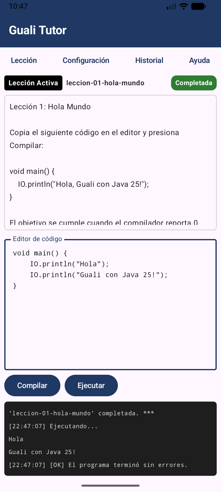
</p>

## Contenido

1. [Prerrequisitos](#1-prerrequisitos)
2. [Software necesario](#2-software-necesario)
3. [Instalación de Android Studio](#3-instalación-de-android-studio)
4. [Crear el proyecto](#4-crear-el-proyecto)
5. [Estructura del proyecto](#5-estructura-del-proyecto)
6. [Modelo de datos](#6-modelo-de-datos)
7. [Tema de la aplicación](#7-tema-de-la-aplicación)
8. [Pantalla principal](#8-pantalla-principal)
9. [MainActivity](#9-mainactivity)
10. [Ejecutar la aplicación en el emulador](#10-ejecutar-la-aplicación-en-el-emulador)
11. [Probar la interfaz](#11-probar-la-interfaz)
12. [Pruebas unitarias](#12-pruebas-unitarias)
13. [Relación con la interfaz principal del enunciado](#13-relación-con-la-interfaz-principal-del-enunciado)

## 1. Prerrequisitos

Conocimientos:

- Programación orientada a objetos y sintaxis básica de Java. Kotlin se lee de forma muy parecida.
- Haber trabajado con la versión de escritorio de Guali Tutor (fases 1 y 2) ayuda a entender qué hace
  cada elemento de la pantalla.

Equipo utilizado para este tutorial:

| Requisito | Valor |
| --- | --- |
| Sistema operativo | Windows 11 de 64 bits |
| Memoria RAM | 16 GB (8 GB como mínimo) |
| Espacio en disco | 12 GB libres para Android Studio, el SDK y el emulador |
| Procesador | x86_64 con virtualización activada en la BIOS (necesaria para el emulador) |
| Conexión a Internet | Para descargar Android Studio, el SDK y las dependencias de Gradle |

## 2. Software necesario

| Software | Versión usada | Para qué se usa |
| --- | --- | --- |
| Android Studio | 2026.2.2 (Rabbit 2) | Entorno de desarrollo. Incluye su propio JDK (JetBrains Runtime), por lo que no hace falta instalar Java aparte |
| Android SDK Platform | API 37 (Android 17.0) | Plataforma con la que se compila la aplicación |
| Android Emulator y una imagen de sistema | API 37, Google Play | Teléfono virtual donde se ejecuta la aplicación |
| Gradle | 9.6.0 (lo descarga el proyecto con el Gradle Wrapper) | Compilación del proyecto |
| Android Gradle Plugin | 9.5.1 | Plugin de Gradle para proyectos Android |
| Kotlin y Jetpack Compose | Kotlin 2.2.10, Compose BOM 2026.02.01 | Lenguaje y biblioteca de interfaz |
| Git | Cualquier versión reciente (opcional) | Para clonar este repositorio |

Gradle, el Android Gradle Plugin, Kotlin y Compose no se instalan a mano: Android Studio los descarga
la primera vez que sincroniza el proyecto.

## 3. Instalación de Android Studio

### 3.1 Descargar el instalador

Descargue Android Studio desde la página oficial <https://developer.android.com/studio>. Para Windows
se obtiene un instalador `.exe` de aproximadamente 1.5 GB. Ejecútelo y acepte el aviso de Windows que
solicita permisos de administrador.

### 3.2 Bienvenida

La primera pantalla del asistente solo da la bienvenida. Presione **Next**.

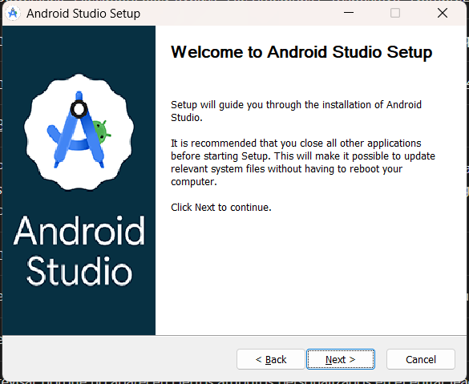

### 3.3 Componentes

Deje marcados **Android Studio** y **Android Virtual Device**. El segundo es el que permite crear
emuladores. Presione **Next**.

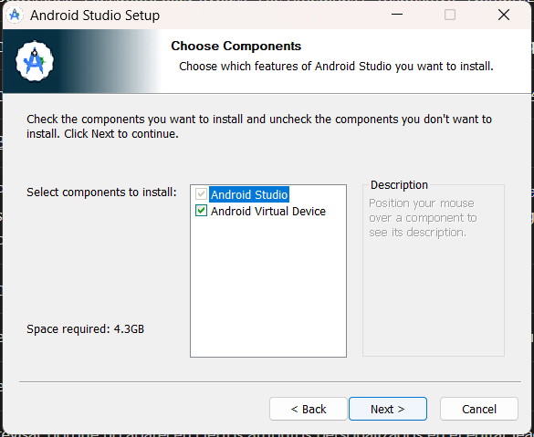

### 3.4 Carpeta del menú Inicio

Deje la carpeta propuesta, **Android Studio**, y presione **Install**.

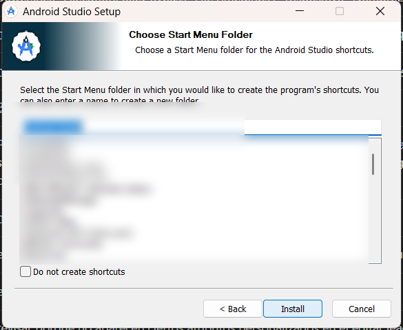

### 3.5 Instalación

Espere a que termine de copiar los archivos.

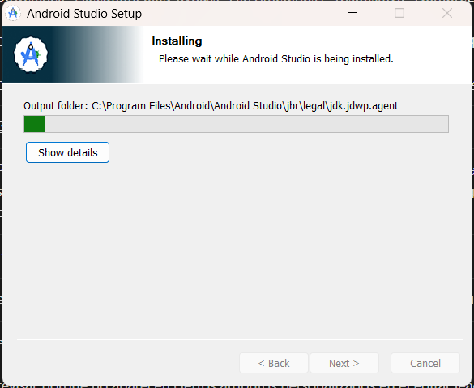

### 3.6 Finalizar

Deje marcado **Start Android Studio** y presione **Finish**.

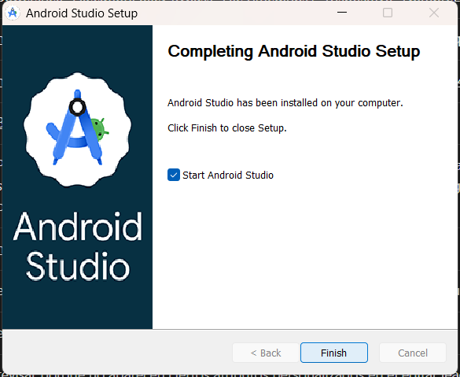

### 3.7 Asistente de configuración inicial

La primera vez que se abre, Android Studio muestra el **Android Studio Setup Wizard**, que descarga el
Android SDK. En ese asistente:

1. En **Install Type** elija **Standard**.
2. Revise el resumen de componentes en **Verify Settings**: incluye la plataforma de Android más
   reciente, las herramientas del SDK, el emulador y una imagen de sistema.
3. En **License Agreement** acepte cada licencia (seleccione cada una y marque **Accept**).
4. Presione **Finish** y espere a que termine la descarga.

Al terminar, el asistente también crea un dispositivo virtual. En este tutorial se llama
**Medium Phone API 37.0**.

### 3.8 Verificar el SDK

Para confirmar que el SDK quedó instalado, abra **File > Settings** (Ctrl+Alt+S) y busque
**Android SDK**. Debe aparecer marcada la plataforma Android 17.0 (API 37.0) y la ruta del SDK, que en
Windows es `C:\Users\<usuario>\AppData\Local\Android\Sdk`.

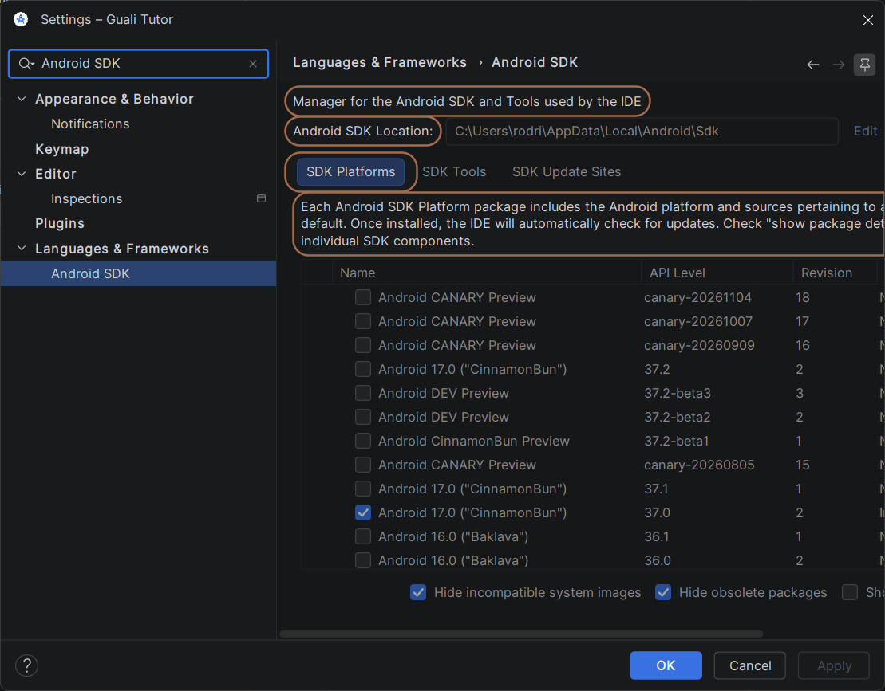

## 4. Crear el proyecto

### 4.1 Pantalla de bienvenida

En la pantalla de bienvenida presione **New Project**.

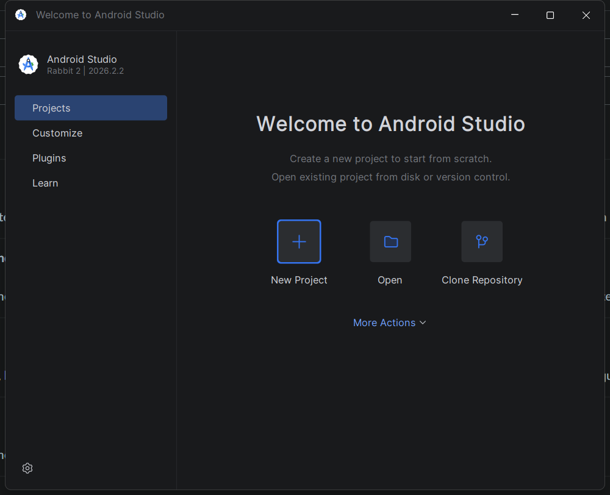

### 4.2 Elegir la plantilla

En **Phone and large screens** elija **Empty Activity**. Es la plantilla que crea una actividad vacía
con Jetpack Compose. Presione **Next**.

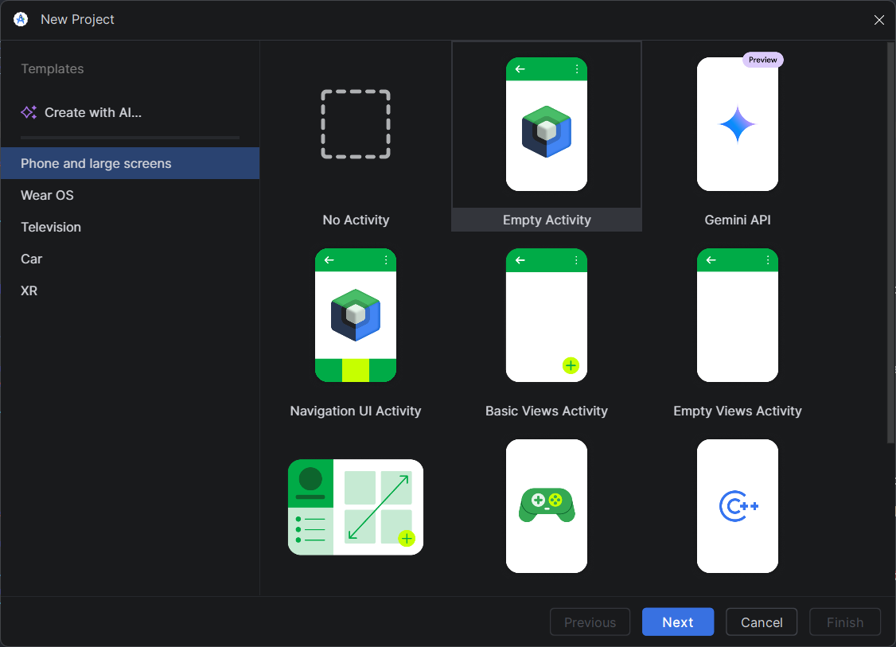

### 4.3 Configurar el proyecto

Complete los campos así y presione **Finish**:

| Campo | Valor |
| --- | --- |
| Name | `Guali Tutor` |
| Package name | `com.guali.tutor` |
| Save location | La carpeta donde quiera guardar el proyecto, por ejemplo `...\GualiTutorAndroid` |
| Minimum SDK | API 24 ("Nougat"; Android 7.0) |

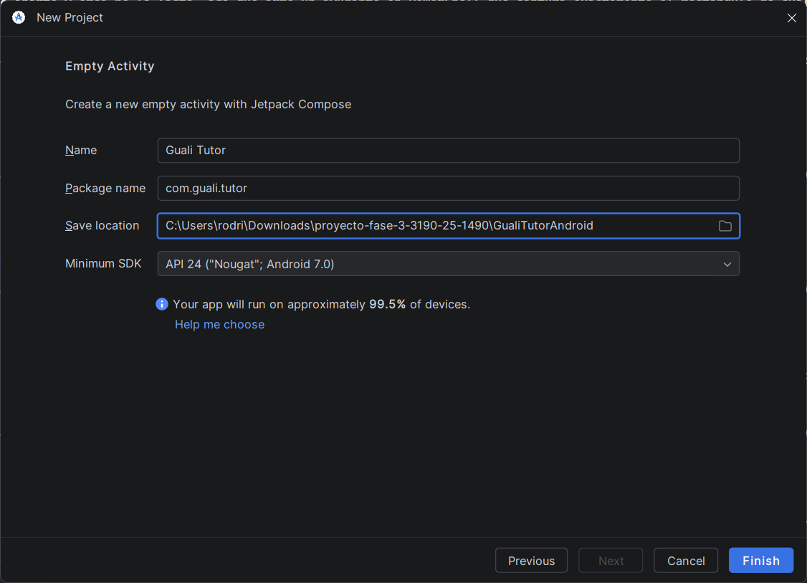

Android Studio crea el proyecto y sincroniza Gradle. La primera sincronización descarga las
dependencias y puede tardar varios minutos; espere a que termine antes de continuar.

## 5. Estructura del proyecto

En la vista **Android** del panel izquierdo, dentro de `kotlin+java/com.guali.tutor`, cree estos
paquetes y archivos (clic derecho sobre el paquete > **New > Package** o **New > Kotlin Class/File**):

```
com.guali.tutor
├── MainActivity.kt          punto de entrada (ya existe, se reemplaza)
├── model
│   ├── Leccion.kt           datos de las lecciones de ejemplo
│   └── Compilador.kt        validación local del código
└── ui
    ├── PantallaPrincipal.kt interfaz principal
    └── theme                colores y tema (ya existe, se ajusta)
```

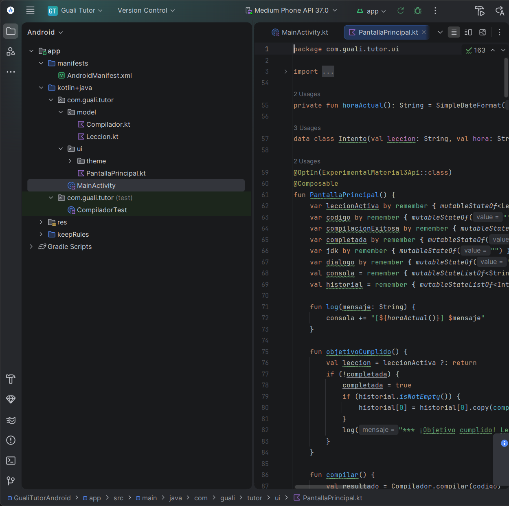

## 6. Modelo de datos

### 6.1 Lecciones

`model/Leccion.kt` define el tipo de objetivo de cada lección, la clase `Leccion` y tres lecciones de
ejemplo, con los mismos objetivos que la aplicación de escritorio.

```kotlin
package com.guali.tutor.model

enum class Objetivo(val nombre: String) {
    COMPILAR_CON_ERROR("Compilar con error"),
    COMPILAR_EXITOSO("Compilar exitoso"),
    EJECUTAR_CON_ERROR("Ejecutar con error"),
    EJECUTAR_EXITOSO("Ejecutar exitoso")
}

data class Leccion(
    val nombre: String,
    val objetivo: Objetivo,
    val contenido: String
)

object LeccionesDeEjemplo {

    val todas = listOf(
        Leccion(
            nombre = "leccion-01-hola-mundo",
            objetivo = Objetivo.COMPILAR_EXITOSO,
            contenido = """
                Lección 1: Hola Mundo

                Copia el siguiente código en el editor y presiona Compilar:

                void main() {
                    IO.println("Hola, Guali con Java 25!");
                }

                El objetivo se cumple cuando el compilador reporta 0 errores.
            """.trimIndent()
        ),
        Leccion(
            nombre = "leccion-02-errores-compilacion",
            objetivo = Objetivo.COMPILAR_CON_ERROR,
            contenido = """
                Lección 2: Errores de compilación

                Copia el código tal cual. A la segunda instrucción le falta el punto y coma:

                void main() {
                    IO.println("Aprendiendo a leer errores");
                    IO.println("Falta el punto y coma")
                }

                El objetivo se cumple cuando el compilador reporta al menos un error.
            """.trimIndent()
        ),
        Leccion(
            nombre = "leccion-04-variables-y-ciclos",
            objetivo = Objetivo.EJECUTAR_EXITOSO,
            contenido = """
                Lección 4: Variables y ciclos

                void main() {
                    int numero = 7;
                    for (int i = 1; i <= 10; i++) {
                        IO.println(numero + " x " + i + " = " + (numero * i));
                    }
                }

                Compila y ejecuta. El objetivo se cumple cuando el programa termina sin errores.
            """.trimIndent()
        )
    )
}
```

### 6.2 Compilador

Este front end todavía no está conectado al servicio que compila Java (guali-dev y la API de la fase 2).
Para que los botones tengan un comportamiento verificable, `model/Compilador.kt` hace una validación
local: revisa que las llaves estén balanceadas y que cada instrucción termine en punto y coma, y al
ejecutar devuelve el texto de cada `IO.println` con una cadena literal. Más adelante esta clase se puede
reemplazar por una que llame a la API sin cambiar la interfaz.

```kotlin
package com.guali.tutor.model

data class ResultadoCompilacion(val exitoso: Boolean, val errores: List<String>)

object Compilador {

    private val printlnLiteral = Regex("""IO\.println\("((?:[^"\\]|\\.)*)"\);""")

    fun compilar(codigo: String): ResultadoCompilacion {
        if (codigo.isBlank()) {
            return ResultadoCompilacion(false, listOf("error: el editor está vacío"))
        }
        val errores = mutableListOf<String>()
        var llaves = 0
        codigo.lines().forEachIndexed { indice, linea ->
            val limpia = linea.trim()
            llaves += limpia.count { it == '{' } - limpia.count { it == '}' }
            val terminaBien = limpia.isEmpty() || limpia.endsWith(";") || limpia.endsWith("{") || limpia.endsWith("}")
            if (!terminaBien) {
                errores += "Main.java:${indice + 1}: error: ';' expected"
            }
        }
        if (llaves != 0) {
            errores += "Main.java: error: reached end of file while parsing"
        }
        return ResultadoCompilacion(errores.isEmpty(), errores)
    }

    fun ejecutar(codigo: String): List<String> =
        printlnLiteral.findAll(codigo).map { it.groupValues[1] }.toList()
}
```

## 7. Tema de la aplicación

La plantilla trae colores morados y activa el color dinámico de Android 12, que toma los colores del
fondo de pantalla. Para que la aplicación se vea igual en cualquier teléfono, reemplace los archivos del
paquete `ui/theme` con la paleta azul de Guali Tutor.

`ui/theme/Color.kt`:

```kotlin
package com.guali.tutor.ui.theme

import androidx.compose.ui.graphics.Color

val AzulGuali = Color(0xFF1F3864)
val AzulGualiClaro = Color(0xFFAFC6FF)
val GrisAzulado = Color(0xFF565F71)
val GrisAzuladoClaro = Color(0xFFBDC7DC)
val VerdeGuali = Color(0xFF2E7D32)
val VerdeGualiClaro = Color(0xFF8BD18E)
```

`ui/theme/Theme.kt`:

```kotlin
package com.guali.tutor.ui.theme

import androidx.compose.foundation.isSystemInDarkTheme
import androidx.compose.material3.MaterialTheme
import androidx.compose.material3.darkColorScheme
import androidx.compose.material3.lightColorScheme
import androidx.compose.runtime.Composable

private val EsquemaOscuro = darkColorScheme(
    primary = AzulGualiClaro,
    secondary = GrisAzuladoClaro,
    tertiary = VerdeGualiClaro
)

private val EsquemaClaro = lightColorScheme(
    primary = AzulGuali,
    secondary = GrisAzulado,
    tertiary = VerdeGuali
)

@Composable
fun GualiTutorTheme(
    darkTheme: Boolean = isSystemInDarkTheme(),
    content: @Composable () -> Unit
) {
    MaterialTheme(
        colorScheme = if (darkTheme) EsquemaOscuro else EsquemaClaro,
        typography = Typography,
        content = content
    )
}
```

## 8. Pantalla principal

`ui/PantallaPrincipal.kt` contiene toda la interfaz. Está dividida en funciones `@Composable`, una por
cada elemento de la pantalla:

| Función | Elemento |
| --- | --- |
| `PantallaPrincipal` | Guarda el estado (lección activa, código, consola, historial) y arma la pantalla con un `Scaffold` |
| `BarraMenu` y `Menu` | Barra de menú con Lección, Configuración, Historial y Ayuda; cada uno abre un `DropdownMenu` |
| `TituloLeccion` | Etiqueta "Lección Activa", nombre de la lección y estado Pendiente o Completada |
| `PanelLeccion` | Texto de la lección con desplazamiento vertical |
| `EditorCodigo` | Campo de texto multilínea con fuente monoespaciada |
| `BotonesAccion` | Botones Compilar y Ejecutar, y el aviso de por qué un botón está deshabilitado |
| `PanelConsola` | Lista con fondo oscuro que se desplaza sola a la última línea |
| `DialogoAbrirLeccion`, `DialogoConfigurarJdk`, `DialogoHistorial`, `DialogoAyuda` | Ventanas de cada opción del menú |

Tres reglas de la aplicación de escritorio se mantienen:

- **Compilar** está deshabilitado hasta configurar el JDK.
- **Ejecutar** solo se habilita después de una compilación exitosa, y se vuelve a deshabilitar en cuanto
  se modifica el código (`onCambio` pone `compilacionExitosa` en `false`).
- Al cumplirse el objetivo de la lección, el título cambia a **Completada** y el intento se marca así en
  el historial.

El estado se guarda con `remember { mutableStateOf(...) }`. Cada vez que cambia, Compose vuelve a dibujar
solo las partes de la pantalla que lo usan. La consola y el historial usan `mutableStateListOf` para que
agregar un elemento también actualice la pantalla.

```kotlin
package com.guali.tutor.ui

import androidx.compose.foundation.background
import androidx.compose.foundation.border
import androidx.compose.foundation.layout.Arrangement
import androidx.compose.foundation.layout.Box
import androidx.compose.foundation.layout.Column
import androidx.compose.foundation.layout.Row
import androidx.compose.foundation.layout.fillMaxSize
import androidx.compose.foundation.layout.fillMaxWidth
import androidx.compose.foundation.layout.height
import androidx.compose.foundation.layout.padding
import androidx.compose.foundation.lazy.LazyColumn
import androidx.compose.foundation.lazy.items
import androidx.compose.foundation.lazy.rememberLazyListState
import androidx.compose.foundation.rememberScrollState
import androidx.compose.foundation.shape.RoundedCornerShape
import androidx.compose.foundation.verticalScroll
import androidx.compose.material3.AlertDialog
import androidx.compose.material3.Button
import androidx.compose.material3.DropdownMenu
import androidx.compose.material3.DropdownMenuItem
import androidx.compose.material3.ExperimentalMaterial3Api
import androidx.compose.material3.MaterialTheme
import androidx.compose.material3.OutlinedTextField
import androidx.compose.material3.Scaffold
import androidx.compose.material3.Surface
import androidx.compose.material3.Text
import androidx.compose.material3.TextButton
import androidx.compose.material3.TopAppBar
import androidx.compose.material3.TopAppBarDefaults
import androidx.compose.runtime.Composable
import androidx.compose.runtime.LaunchedEffect
import androidx.compose.runtime.getValue
import androidx.compose.runtime.mutableStateListOf
import androidx.compose.runtime.mutableStateOf
import androidx.compose.runtime.remember
import androidx.compose.runtime.setValue
import androidx.compose.ui.Alignment
import androidx.compose.ui.Modifier
import androidx.compose.ui.graphics.Color
import androidx.compose.ui.text.font.FontFamily
import androidx.compose.ui.text.font.FontWeight
import androidx.compose.ui.text.style.TextOverflow
import androidx.compose.ui.unit.dp
import androidx.compose.ui.unit.sp
import com.guali.tutor.model.Compilador
import com.guali.tutor.model.Leccion
import com.guali.tutor.model.LeccionesDeEjemplo
import com.guali.tutor.model.Objetivo
import java.text.SimpleDateFormat
import java.util.Date
import java.util.Locale

private fun horaActual(): String = SimpleDateFormat("HH:mm:ss", Locale.getDefault()).format(Date())

data class Intento(val leccion: String, val hora: String, val completada: Boolean)

@OptIn(ExperimentalMaterial3Api::class)
@Composable
fun PantallaPrincipal() {
    var leccionActiva by remember { mutableStateOf<Leccion?>(null) }
    var codigo by remember { mutableStateOf("") }
    var compilacionExitosa by remember { mutableStateOf(false) }
    var completada by remember { mutableStateOf(false) }
    var jdk by remember { mutableStateOf("") }
    var dialogo by remember { mutableStateOf("") }
    val consola = remember { mutableStateListOf<String>() }
    val historial = remember { mutableStateListOf<Intento>() }

    fun log(mensaje: String) {
        consola += "[${horaActual()}] $mensaje"
    }

    fun objetivoCumplido() {
        val leccion = leccionActiva ?: return
        if (!completada) {
            completada = true
            if (historial.isNotEmpty()) {
                historial[0] = historial[0].copy(completada = true)
            }
            log("*** ¡Objetivo cumplido! Lección '${leccion.nombre}' completada. ***")
        }
    }

    fun compilar() {
        val resultado = Compilador.compilar(codigo)
        compilacionExitosa = resultado.exitoso
        if (resultado.exitoso) {
            log("[OK] Compilación exitosa, 0 errores.")
        } else {
            log("[ERROR] El compilador reportó errores:")
            resultado.errores.forEach { consola += it }
        }
        val objetivo = leccionActiva?.objetivo
        if ((objetivo == Objetivo.COMPILAR_EXITOSO && resultado.exitoso) ||
            (objetivo == Objetivo.COMPILAR_CON_ERROR && !resultado.exitoso)
        ) {
            objetivoCumplido()
        }
    }

    fun ejecutar() {
        log("Ejecutando...")
        Compilador.ejecutar(codigo).forEach { consola += it }
        log("[OK] El programa terminó sin errores.")
        if (leccionActiva?.objetivo == Objetivo.EJECUTAR_EXITOSO) {
            objetivoCumplido()
        }
    }

    LaunchedEffect(Unit) {
        log("Guali Tutor iniciado.")
        log("[AVISO] El JDK no está configurado. Use Configuración > Configurar JDK.")
    }

    Scaffold(
        topBar = {
            TopAppBar(
                title = { Text("Guali Tutor", fontWeight = FontWeight.Bold) },
                colors = TopAppBarDefaults.topAppBarColors(
                    containerColor = MaterialTheme.colorScheme.primary,
                    titleContentColor = MaterialTheme.colorScheme.onPrimary
                )
            )
        }
    ) { relleno ->
        Column(
            modifier = Modifier
                .fillMaxSize()
                .padding(relleno)
                .padding(horizontal = 8.dp)
        ) {
            BarraMenu(
                hayLeccion = leccionActiva != null,
                onAbrir = { dialogo = "abrir" },
                onCerrar = {
                    log("Lección cerrada: ${leccionActiva?.nombre}")
                    leccionActiva = null
                    codigo = ""
                    compilacionExitosa = false
                },
                onConfigurarJdk = { dialogo = "jdk" },
                onHistorial = { dialogo = "historial" },
                onAyuda = { dialogo = "ayuda" }
            )
            TituloLeccion(leccionActiva, completada)
            PanelLeccion(
                texto = leccionActiva?.contenido
                    ?: "Bienvenido a Guali Tutor.\n\nNo hay una lección activa. Use Lección > Abrir Lección.",
                modifier = Modifier.weight(1f)
            )
            EditorCodigo(
                codigo = codigo,
                onCambio = {
                    codigo = it
                    compilacionExitosa = false
                },
                modifier = Modifier.weight(1f)
            )
            BotonesAccion(
                jdkConfigurado = jdk.isNotBlank(),
                puedeEjecutar = jdk.isNotBlank() && compilacionExitosa,
                onCompilar = { compilar() },
                onEjecutar = { ejecutar() }
            )
            PanelConsola(consola)
        }
    }

    when (dialogo) {
        "abrir" -> DialogoAbrirLeccion(
            onElegir = {
                leccionActiva = it
                codigo = ""
                compilacionExitosa = false
                completada = false
                historial.add(0, Intento(it.nombre, horaActual(), false))
                log("Lección abierta: ${it.nombre}")
                log("Objetivo: ${it.objetivo.nombre}")
                dialogo = ""
            },
            onCerrar = { dialogo = "" }
        )
        "jdk" -> DialogoConfigurarJdk(
            actual = jdk,
            onGuardar = {
                jdk = it
                log("JDK configurado: $it")
                dialogo = ""
            },
            onCerrar = { dialogo = "" }
        )
        "historial" -> DialogoHistorial(historial) { dialogo = "" }
        "ayuda" -> DialogoAyuda { dialogo = "" }
    }
}

@Composable
fun BarraMenu(
    hayLeccion: Boolean,
    onAbrir: () -> Unit,
    onCerrar: () -> Unit,
    onConfigurarJdk: () -> Unit,
    onHistorial: () -> Unit,
    onAyuda: () -> Unit
) {
    Row(modifier = Modifier.fillMaxWidth(), horizontalArrangement = Arrangement.SpaceBetween) {
        Menu("Lección", listOf("Abrir Lección" to onAbrir, "Cerrar Lección" to onCerrar), hayLeccion)
        Menu("Configuración", listOf("Configurar JDK" to onConfigurarJdk))
        Menu("Historial", listOf("Ver Historial" to onHistorial))
        Menu("Ayuda", listOf("Guía de Uso" to onAyuda))
    }
}

@Composable
fun Menu(titulo: String, opciones: List<Pair<String, () -> Unit>>, permiteCerrar: Boolean = true) {
    var abierto by remember { mutableStateOf(false) }
    Box {
        TextButton(onClick = { abierto = true }) {
            Text(titulo, fontWeight = FontWeight.SemiBold)
        }
        DropdownMenu(expanded = abierto, onDismissRequest = { abierto = false }) {
            opciones.forEach { (texto, accion) ->
                DropdownMenuItem(
                    text = { Text(texto) },
                    enabled = texto != "Cerrar Lección" || permiteCerrar,
                    onClick = {
                        abierto = false
                        accion()
                    }
                )
            }
        }
    }
}

@Composable
fun TituloLeccion(leccion: Leccion?, completada: Boolean) {
    Row(
        modifier = Modifier
            .fillMaxWidth()
            .padding(vertical = 4.dp),
        verticalAlignment = Alignment.CenterVertically
    ) {
        Text(
            "Lección Activa",
            color = Color.White,
            fontWeight = FontWeight.Bold,
            fontSize = 13.sp,
            modifier = Modifier
                .background(Color.Black, RoundedCornerShape(4.dp))
                .padding(horizontal = 8.dp, vertical = 2.dp)
        )
        Text(
            text = "  " + (leccion?.nombre ?: "Ninguna"),
            fontWeight = FontWeight.SemiBold,
            fontSize = 13.sp,
            maxLines = 1,
            overflow = TextOverflow.Ellipsis,
            modifier = Modifier.weight(1f)
        )
        if (leccion != null) {
            Text(
                if (completada) "Completada" else "Pendiente",
                color = Color.White,
                fontSize = 12.sp,
                fontWeight = FontWeight.Bold,
                modifier = Modifier
                    .background(
                        if (completada) Color(0xFF2E7D32) else Color(0xFFC62828),
                        RoundedCornerShape(10.dp)
                    )
                    .padding(horizontal = 8.dp, vertical = 2.dp)
            )
        }
    }
}

@Composable
fun PanelLeccion(texto: String, modifier: Modifier = Modifier) {
    Surface(
        modifier = modifier
            .fillMaxWidth()
            .padding(vertical = 4.dp)
            .border(1.dp, Color.LightGray, RoundedCornerShape(6.dp)),
        shape = RoundedCornerShape(6.dp)
    ) {
        Text(
            text = texto,
            fontSize = 14.sp,
            modifier = Modifier
                .padding(10.dp)
                .verticalScroll(rememberScrollState())
        )
    }
}

@Composable
fun EditorCodigo(codigo: String, onCambio: (String) -> Unit, modifier: Modifier = Modifier) {
    OutlinedTextField(
        value = codigo,
        onValueChange = onCambio,
        label = { Text("Editor de código") },
        textStyle = MaterialTheme.typography.bodyMedium.copy(fontFamily = FontFamily.Monospace, fontSize = 13.sp),
        modifier = modifier
            .fillMaxWidth()
            .padding(vertical = 4.dp)
    )
}

@Composable
fun BotonesAccion(
    jdkConfigurado: Boolean,
    puedeEjecutar: Boolean,
    onCompilar: () -> Unit,
    onEjecutar: () -> Unit
) {
    Column(modifier = Modifier.fillMaxWidth()) {
        Row(horizontalArrangement = Arrangement.spacedBy(8.dp)) {
            Button(onClick = onCompilar, enabled = jdkConfigurado) { Text("Compilar") }
            Button(onClick = onEjecutar, enabled = puedeEjecutar) { Text("Ejecutar") }
        }
        val aviso = when {
            !jdkConfigurado -> "Se requiere configurar el JDK antes de continuar."
            !puedeEjecutar -> "Ejecutar se habilita después de una compilación exitosa."
            else -> ""
        }
        if (aviso.isNotEmpty()) {
            Text(aviso, color = Color(0xFFC62828), fontSize = 12.sp)
        }
    }
}

@Composable
fun PanelConsola(lineas: List<String>) {
    val estado = rememberLazyListState()
    LaunchedEffect(lineas.size) {
        if (lineas.isNotEmpty()) estado.animateScrollToItem(lineas.size - 1)
    }
    LazyColumn(
        state = estado,
        modifier = Modifier
            .fillMaxWidth()
            .height(150.dp)
            .padding(vertical = 6.dp)
            .background(Color(0xFF1E1E1E), RoundedCornerShape(6.dp))
            .padding(8.dp)
    ) {
        items(lineas) {
            Text(it, color = Color(0xFFD4D4D4), fontFamily = FontFamily.Monospace, fontSize = 11.sp)
        }
    }
}

@Composable
fun DialogoAbrirLeccion(onElegir: (Leccion) -> Unit, onCerrar: () -> Unit) {
    AlertDialog(
        onDismissRequest = onCerrar,
        title = { Text("Abrir Lección") },
        text = {
            Column {
                LeccionesDeEjemplo.todas.forEach { leccion ->
                    TextButton(onClick = { onElegir(leccion) }) {
                        Column(modifier = Modifier.fillMaxWidth()) {
                            Text(leccion.nombre, fontWeight = FontWeight.SemiBold)
                            Text(leccion.objetivo.nombre, fontSize = 12.sp)
                        }
                    }
                }
            }
        },
        confirmButton = {},
        dismissButton = { TextButton(onClick = onCerrar) { Text("Cancelar") } }
    )
}

@Composable
fun DialogoConfigurarJdk(actual: String, onGuardar: (String) -> Unit, onCerrar: () -> Unit) {
    var ruta by remember { mutableStateOf(actual.ifBlank { "C:\\Program Files\\Java\\jdk-25" }) }
    AlertDialog(
        onDismissRequest = onCerrar,
        title = { Text("Configurar JDK") },
        text = {
            OutlinedTextField(
                value = ruta,
                onValueChange = { ruta = it },
                label = { Text("Carpeta raíz del JDK") },
                singleLine = true
            )
        },
        confirmButton = {
            TextButton(onClick = { onGuardar(ruta.trim()) }, enabled = ruta.isNotBlank()) { Text("Aceptar") }
        },
        dismissButton = { TextButton(onClick = onCerrar) { Text("Cancelar") } }
    )
}

@Composable
fun DialogoHistorial(historial: List<Intento>, onCerrar: () -> Unit) {
    AlertDialog(
        onDismissRequest = onCerrar,
        title = { Text("Historial de Sesión") },
        text = {
            if (historial.isEmpty()) {
                Text("Todavía no hay intentos registrados.")
            } else {
                Column {
                    historial.forEach {
                        Row(modifier = Modifier.fillMaxWidth().padding(vertical = 4.dp)) {
                            Text(it.leccion, fontSize = 13.sp, modifier = Modifier.weight(1f))
                            Text(it.hora, fontSize = 13.sp, modifier = Modifier.padding(horizontal = 6.dp))
                            Text(
                                if (it.completada) "Completada" else "Pendiente",
                                fontSize = 13.sp,
                                color = if (it.completada) Color(0xFF2E7D32) else Color(0xFFC62828)
                            )
                        }
                    }
                }
            }
        },
        confirmButton = { TextButton(onClick = onCerrar) { Text("Cerrar") } }
    )
}

@Composable
fun DialogoAyuda(onCerrar: () -> Unit) {
    AlertDialog(
        onDismissRequest = onCerrar,
        title = { Text("Guía de Uso") },
        text = {
            Text(
                "1. Configure el JDK en Configuración > Configurar JDK.\n" +
                    "2. Abra una lección en Lección > Abrir Lección.\n" +
                    "3. Copie el código de la lección en el editor.\n" +
                    "4. Presione Compilar y, si no hay errores, Ejecutar.\n" +
                    "5. Revise la salida en la consola y sus intentos en Historial."
            )
        },
        confirmButton = { TextButton(onClick = onCerrar) { Text("Entendido") } }
    )
}
```

## 9. MainActivity

Por último, reemplace el contenido de `MainActivity.kt` para que muestre la pantalla principal dentro
del tema de la aplicación:

```kotlin
package com.guali.tutor

import android.os.Bundle
import androidx.activity.ComponentActivity
import androidx.activity.compose.setContent
import androidx.activity.enableEdgeToEdge
import com.guali.tutor.ui.PantallaPrincipal
import com.guali.tutor.ui.theme.GualiTutorTheme

class MainActivity : ComponentActivity() {
    override fun onCreate(savedInstanceState: Bundle?) {
        super.onCreate(savedInstanceState)
        enableEdgeToEdge()
        setContent {
            GualiTutorTheme {
                PantallaPrincipal()
            }
        }
    }
}
```

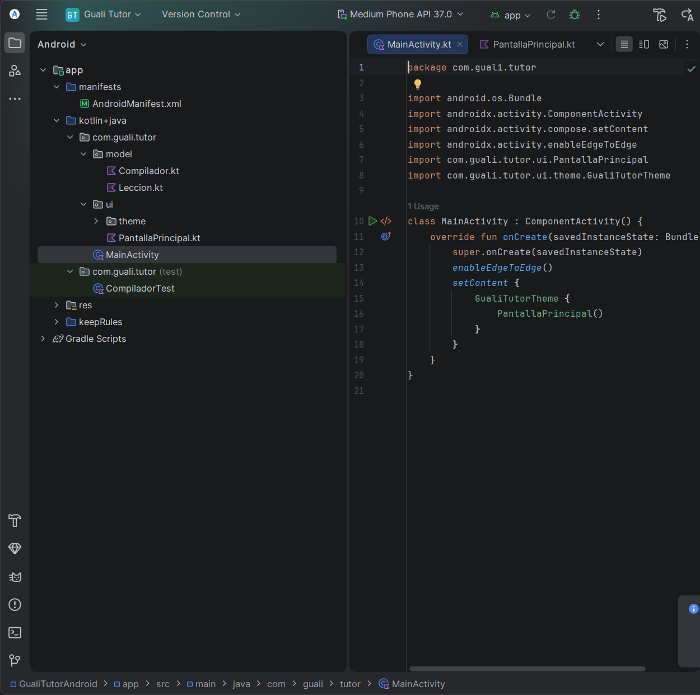

## 10. Ejecutar la aplicación en el emulador

1. En la barra superior de Android Studio verifique que está seleccionado el dispositivo
   **Medium Phone API 37.0** y la configuración **app**. Si no hay ningún dispositivo, créelo en
   **Tools > Device Manager > Create Virtual Device** eligiendo un teléfono y la imagen de API 37.
2. Presione el botón **Run** (triángulo verde) o Shift+F10.
3. La primera vez el emulador tarda en arrancar. Cuando termina, Android Studio instala y abre la
   aplicación.

La aplicación inicia sin lección activa, con los botones deshabilitados y el aviso de que falta
configurar el JDK.

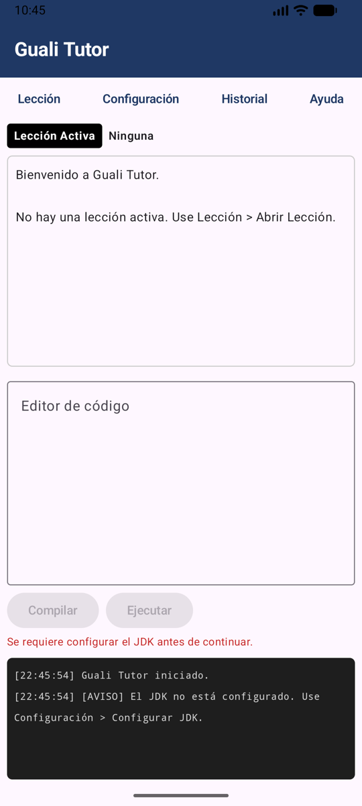

También se puede compilar desde una terminal en la carpeta del proyecto:

```bash
./gradlew assembleDebug
```

El APK queda en `app/build/outputs/apk/debug/app-debug.apk`.

## 11. Probar la interfaz

### 11.1 Configurar el JDK

Abra **Configuración > Configurar JDK**, revise la ruta y presione **Aceptar**. El botón Compilar se
habilita.

<p>
  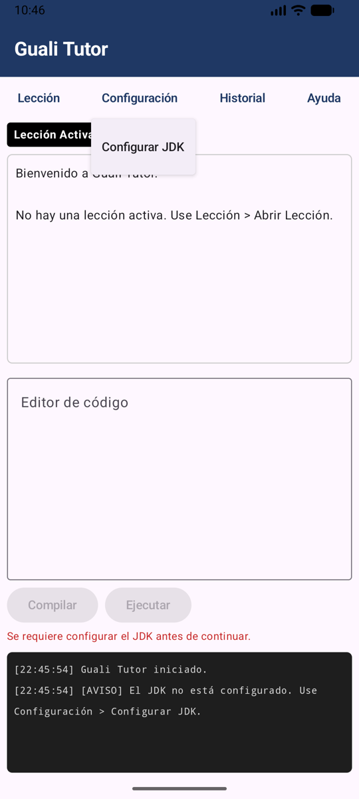
  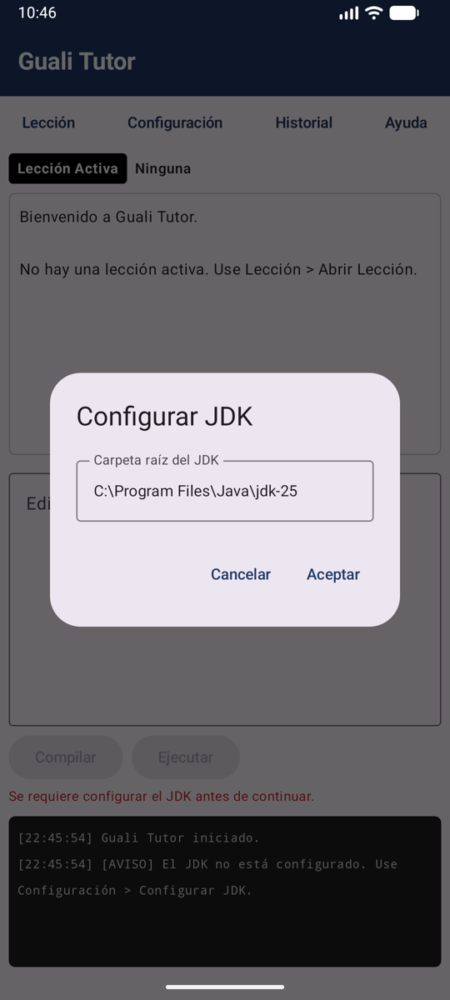
</p>

### 11.2 Abrir una lección

Abra **Lección > Abrir Lección** y elija **leccion-02-errores-compilacion**. El panel muestra el texto
de la lección y el título indica que está Pendiente.

<p>
  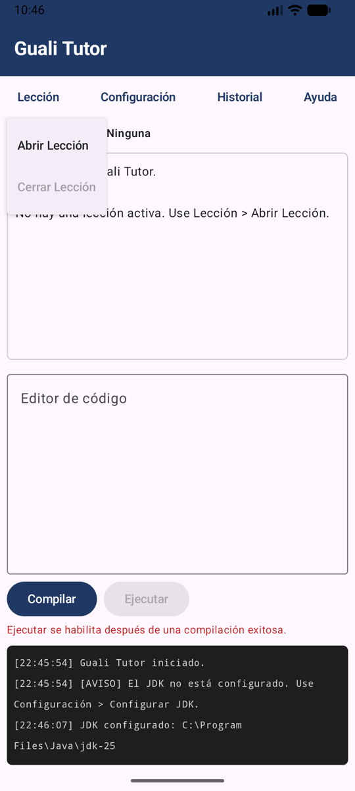
  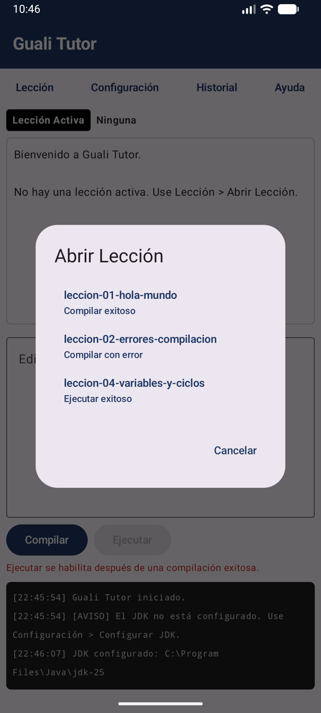
  
</p>

### 11.3 Compilar con error

Copie el código de la lección en el editor. Como a la tercera línea le falta el punto y coma, al
presionar **Compilar** la consola muestra `Main.java:3: error: ';' expected`. El objetivo de esta lección
es justamente compilar con error, así que la lección queda Completada. Ejecutar sigue deshabilitado
porque la compilación no fue exitosa.

<p>
  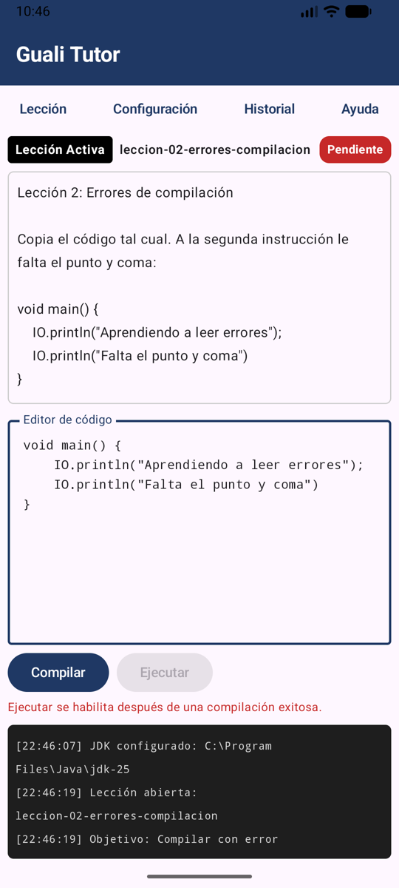
  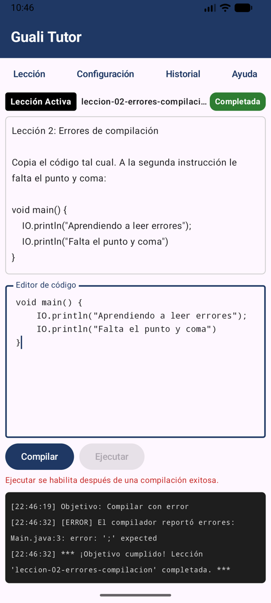
</p>

### 11.4 Compilar y ejecutar con éxito

Abra **leccion-01-hola-mundo**, escriba un programa correcto y presione **Compilar**: la consola
indica 0 errores y se habilita **Ejecutar**. Al ejecutar, la consola muestra la salida del programa.

<p>
  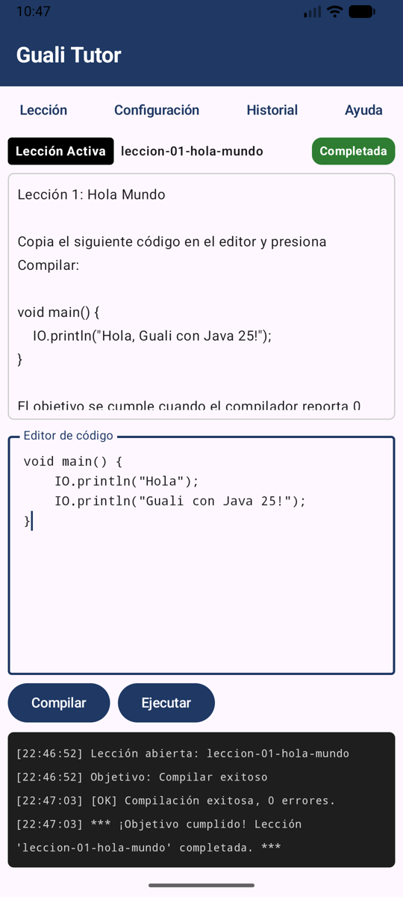
  
</p>

### 11.5 Historial y ayuda

**Historial > Ver Historial** lista cada lección abierta con su hora y su estado. **Ayuda > Guía de
Uso** muestra los pasos básicos.

<p>
  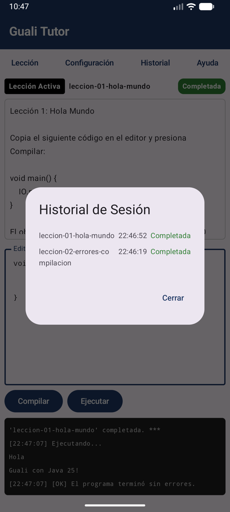
  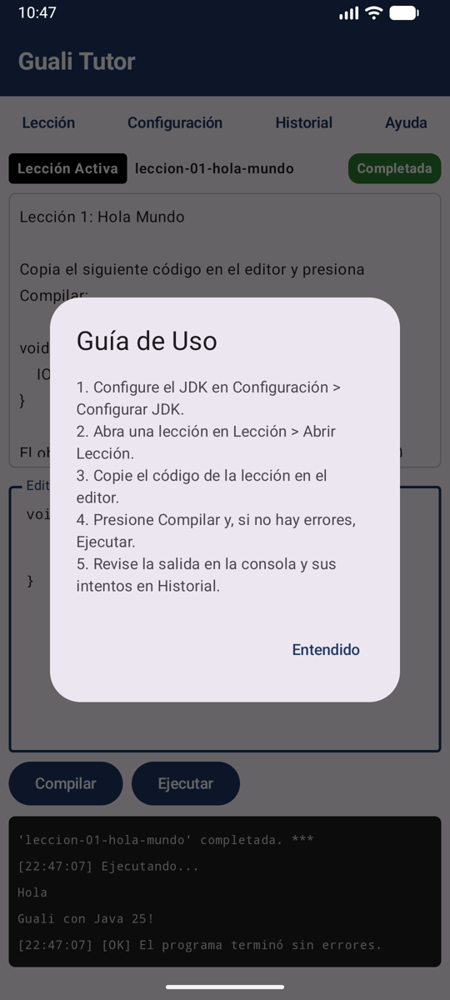
</p>

## 12. Pruebas unitarias

`app/src/test/java/com/guali/tutor/CompiladorTest.kt` comprueba la validación local del código:

```kotlin
package com.guali.tutor

import com.guali.tutor.model.Compilador
import org.junit.Assert.assertEquals
import org.junit.Assert.assertFalse
import org.junit.Assert.assertTrue
import org.junit.Test

class CompiladorTest {

    @Test
    fun codigoCorrectoCompilaSinErrores() {
        val resultado = Compilador.compilar(
            """
            void main() {
                IO.println("Hola, Guali con Java 25!");
            }
            """.trimIndent()
        )
        assertTrue(resultado.exitoso)
        assertTrue(resultado.errores.isEmpty())
    }

    @Test
    fun faltaPuntoYComaReportaLaLinea() {
        val resultado = Compilador.compilar(
            """
            void main() {
                IO.println("Aprendiendo a leer errores");
                IO.println("Falta el punto y coma")
            }
            """.trimIndent()
        )
        assertFalse(resultado.exitoso)
        assertEquals(listOf("Main.java:3: error: ';' expected"), resultado.errores)
    }

    @Test
    fun llavesSinCerrarEsError() {
        val resultado = Compilador.compilar("void main() {\n    IO.println(\"x\");")
        assertFalse(resultado.exitoso)
        assertEquals(listOf("Main.java: error: reached end of file while parsing"), resultado.errores)
    }

    @Test
    fun editorVacioEsError() {
        val resultado = Compilador.compilar("   ")
        assertFalse(resultado.exitoso)
        assertEquals(listOf("error: el editor está vacío"), resultado.errores)
    }

    @Test
    fun ejecutarDevuelveLosTextosDeIOPrintln() {
        val salida = Compilador.ejecutar(
            """
            void main() {
                IO.println("Hola");
                IO.println("Guali con Java 25!");
            }
            """.trimIndent()
        )
        assertEquals(listOf("Hola", "Guali con Java 25!"), salida)
    }
}
```

Se ejecutan con:

```bash
./gradlew testDebugUnitTest
```

## 13. Relación con la interfaz principal del enunciado

| Elemento del enunciado | Implementación en Android |
| --- | --- |
| Barra de Menú | `BarraMenu`: Lección (Abrir, Cerrar), Configuración (Configurar JDK), Historial (Ver Historial), Ayuda (Guía de Uso) |
| Título de lección activa | `TituloLeccion` |
| Panel de lección activa | `PanelLeccion` |
| Editor de Código | `EditorCodigo` |
| Panel de Consola | `PanelConsola` |
| Botón Compilar | `BotonesAccion`, habilitado con el JDK configurado |
| Botón Ejecutar | `BotonesAccion`, habilitado solo después de una compilación exitosa |
| Panel Historial de Sesión | `DialogoHistorial` con su botón Cerrar |
